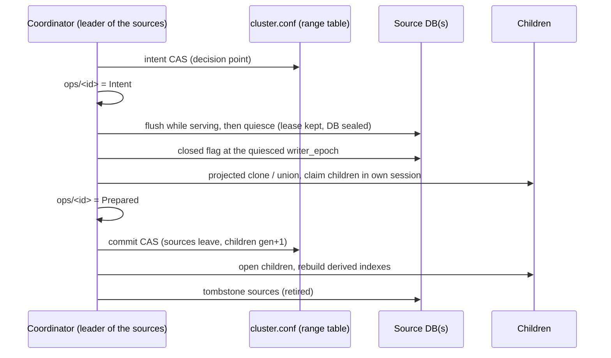

# Architecture

This page explains how cairnflow keeps durable execution correct with **no local disks**: every
byte of state lives in an object store, nodes are stateless, and the only coordination primitive
is the conditional PUT the store already offers. It is written for someone deciding whether to
trust the design. Each rule is named by a code (`D11`, `LS-3`, `SM-9`, …) registered with its
proving tests in [`docs/design/decisions.md`](design/decisions.md); the subsystem guides in
[`docs/guides/`](guides/) go one level deeper.

Contents:

1. [What runs where](#1-what-runs-where)
2. [Where state lives](#2-where-state-lives)
3. [Who may write: sessions, owner records and fencing](#3-who-may-write-sessions-owner-records-and-fencing)
4. [The commit path: one shared WAL per node, acknowledge after durable](#4-the-commit-path-one-shared-wal-per-node-acknowledge-after-durable)
5. [Turns, flow control and messages between ranges](#5-turns-flow-control-and-messages-between-ranges)
6. [Ranges: split and merge](#6-ranges-split-and-merge)
7. [Deleting safely: GC, delete proofs and the trash](#7-deleting-safely-gc-delete-proofs-and-the-trash)
8. [Format freeze and migrations](#8-format-freeze-and-migrations)
9. [The SlateDB fork](#9-the-slatedb-fork)
10. [Failure model: what is and is not guaranteed](#10-failure-model-what-is-and-is-not-guaranteed)
11. [How the design is checked](#11-how-the-design-is-checked)

---

## 1. What runs where

```
            clients (HTTP / typed TS client)            your services (SDK, HTTP)
                         │                                        ▲
                         ▼                                        │ turns: BIDI_STREAM
   ┌─────────────────────────────────────────┐                    │ or REQUEST_RESPONSE
   │ cairnflow node  (stateless process)     │────────────────────┘
   │  ingress ─► range actors ─► engines     │◄──── /internal/* (HMAC) ────► other nodes
   │            (one engine per led range)   │
   │  session keeper · shared WAL · GC loops │
   └──────────────┬──────────────────────────┘
                  │ GET / PUT (conditional) / LIST / DELETE
                  ▼
   ┌─────────────────────────────────────────┐
   │ object store: main tier (+ optional WAL │
   │ tier). The only source of truth.        │
   └─────────────────────────────────────────┘
```

- A **node** (`cairnflow`) holds no state of its own. Kill it with `-9`, start it anywhere with
  the same store URI, and it picks up where the cluster is.
- The partition-key space (`u64`) is cut into contiguous **ranges** by a versioned range table.
  Each range has exactly one **leader** node at a time, one SlateDB database and one
  single-threaded **engine** that runs every state change of that range (D10, INV-4).
- **Services** are your HTTP processes built with the SDK. The engine drives a handler through
  *turns*: it replays the invocation's journal to the SDK and records each new step durably
  before telling anyone about it. An invocation's id carries its partition key, so its range is
  known from the id alone ([`docs/key-design.md`](key-design.md)).
- Several nodes pointed at the same bucket form a cluster; one node is simply a one-node cluster.
  There is no separate consensus service: no Raft, no etcd, no Postgres. That choice is the
  thesis of the project — a database with disks that operators must run would defeat it.

## 2. Where state lives

A node takes two store locations (D7): `--main-store` for everything, and an optional
`--wal-store` that holds only WAL objects, for deployments that want a lower-latency store on
the commit path. Supported URIs are `s3://bucket/prefix` (any S3-compatible store that passes
the start-up probes), `file://` / `--data-dir` (one node only), and `memory://` (tests).

Under the cluster prefix of the main store:

| Object | Purpose |
|---|---|
| `format`, `cluster-version` | Data format marker (10, frozen) and migration state (section 8) |
| `cluster.conf`, `cluster-history/<version>` | The range table, changed only by CAS, and a copy of every winning version (SM-2, SM-22) |
| `sessions/<node>/<inc>`, `incarnations/<node>/<inc>` | One liveness record per node incarnation (section 3) |
| `owners/range-<id>` | Who leads a range, and where its WAL frames are (sections 3 and 4) |
| `ranges/<id>/…` | The SlateDB database of one range (manifests, SSTs) |
| `nodewal/<node>/<inc>/<stripe>/<seq>` | The per-node shared WAL (section 4) |
| `ops/<key>`, `gc-barriers/<id>`, `gc-swept`, `trash/<date>/<id>/…` | Split/merge op ledgers, GC barriers and the trash (sections 6 and 7) |
| `catalog/<tenant>`, `deployments/…`, `tenants`, `auth/…`, `rules`, `range-windows`, … | Configuration: deployments, tenants, API keys, flow-control rules |
| `archive/…`, `artifacts/…`, `values/…`, `audit/…`, `metering/…` | Customer data that lives outside range DBs: archived journals, artifacts, large state values, audit export, usage |

Every object cairn writes has a line in `OBJECT_POLICIES` (`crates/cairn-store/src/format.rs`)
that says how strictly it is read; a test fails when an object is written without one.

**Inside a range DB** the keyspace is ordered by the partition key of the row's owner, in three
zones (D21): `0x00 ‖ owner_pk ‖ table ‖ …` for hot entity rows (invocation status, timers,
outbox, inbound, locks), `0x01 ‖ index ‖ …` for derived indexes that sit outside every range and
are rebuilt from the owned rows, and `0x02 ‖ owner_pk ‖ …` for bulk data (journal, state). A
range therefore covers exactly two contiguous byte ranges, which is what lets a split be a
metadata operation (section 6).

All pending work — timers, queued invocations, outbox rows, retries, locks — is a row in the
range DB, never only in leader memory (INV-3). A new leader rebuilds every in-memory structure
from the store before serving (LS-9, FL-8).

## 3. Who may write: sessions, owner records and fencing

Three layers, each with one job ([`docs/guides/lease-session.md`](guides/lease-session.md)):

```
 sessions/<node>/<inc>   "this node incarnation is alive"   renewed once for all its ranges (D20)
 owners/range-<id>       "this range is led by session S"   written only when ownership changes
 SlateDB writer_epoch    "only the newest writer can make   the actual write fence
  + conditional PUT       writes durable"
```

**Start-up gates.** A store that does not honour `PutMode::Create` — and, for more than one node,
`PutMode::Update` on an etag — is refused before anything is written (D12). Without real
conditional PUT nothing below holds, so cairnflow will not run on such a store.

**Sessions.** A node creates `sessions/<node>/<inc>` for each incarnation and renews it by CAS.
`expired` and `closed` are terminal: a node that lost its session starts a new incarnation and
never revives the old one (LS-1). An observer may CAS `expired` onto a session only after one
TTL of silence measured from when it *received* the last beat; nobody concludes death from its
own clock alone. Two optional quieter renewal modes cut idle requests — a lone node renews by a
conditional GET of its own record (`solo`, LS-16), and in a multi-node cluster a coordinator
renews on behalf of the others (`delegated`, LS-14, LS-15) — and both are gated behind a
bucket-wide switch that is only turned on after the store passes a conditional-GET probe
(LS-16a, G18).

**Owner records.** Taking a range is one CAS on `owners/range-<id>`; of two claimants exactly
one wins (LS-3). An ambiguous CAS result is resolved by reading back (rule 7, below). A leader's
right to act is a *grant* that expires by its own monotonic clock at two thirds of the TTL after
the renewal was issued; past that it pauses acknowledgements and read replies until a renewal
CAS wins again or the grant is lost for good (LS-2).

**Fencing.** Opening a range writer bumps SlateDB's `writer_epoch`, which fences the previous
writer — including a frozen process that has not noticed it lost leadership. Such a zombie can
still `put`, but its durability wait fails, which is why nothing is acknowledged before that
wait (LS-4, D11). The type system makes the single-writer rule a compile-time property inside a
node (D10): the writer is neither `Clone` nor `Send`.

**Every reply is fenced too.** Each `Committed` ticket requires a valid grant, and each command
reply at the leader also passes a *read fence*: a conditional GET of the node's own session
record issued after the read, batched once per node (LS-5). A leader that has been replaced
cannot answer from stale memory.

**Ambiguous writes.** The object-store client retries 5xx responses even for conditional PUTs,
so `Precondition` / `AlreadyExists` may be our own earlier success and an error may have landed
(OS1). Every conditional write therefore goes through `cas::put_resolving`: read back and compare
with what we meant to write. Only the shared WAL on stores without atomic PUT treats
`AlreadyExists` as a fence instead (NW-2). A test profile injects one ambiguous outcome into
every store operation of the cluster tests (`CAIRNFLOW_TEST_FAULTS=each-once`,
[`docs/testing.md`](testing.md)).

**Losing leadership** is detected in three layers — grant loss, a `Fenced` error or stalled
durability from the store, and a periodic owner-record watch — and each makes the range step
down (LS-6). A range without a leader answers `503 NotLeader` immediately rather than queuing
(N3, LS-7).

## 4. The commit path: one shared WAL per node, acknowledge after durable

SlateDB normally gives every database its own WAL. With hundreds of ranges per node that would
mean hundreds of WAL PUT streams. Cairnflow instead multiplexes the WAL of every range a node
leads into `S` log streams per node incarnation (`--wal-stripes`, default 2; D-i), through a
WAL trait added in the SlateDB fork (F1). WAL PUTs scale with nodes, not ranges
([`docs/guides/nodewal.md`](guides/nodewal.md)).

```
 engine turn ──► Mutations ──► PartitionWriter::commit ──► SlateDB write (memtable)
                                                              │ frame
                                                              ▼
                       stripe of this node: batch frames for ≤ --wal-window-ms
                                                              │ PUT Create
                                                              ▼
                       nodewal/<node>/<inc>/<stripe>/<seq>  ── success, in order ──► WalFlushed
                                                              │
                       durable_seq advances ──► Committed ticket ──► reply / SDK / peer range
```

The rules that make this safe:

- **Acknowledge only after the PUT, in stream order** (NW-1, D11, INV-5). With several PUTs in
  flight, object `n+1` is acknowledged only after object `n`.
- **A log is written only by its own incarnation**, always with `PutMode::Create` (NW-2). A
  `Fenced` result kills the stream and fail-stops the node incarnation; a stalled PUT only
  rotates its own stripe (D-i).
- **Taking over a range** seals the previous owner's logs at the first gap above their durable
  GC floor (NW-3), replays them into the DB, lists the new owner's segment in the owner record
  *before* writing any frame (C4), flushes the replayed rows to L0 (C6), drops the old segments
  by the replay mark of the *stored* manifest (C7, NW-4), and only then serves.
- **GC of the log** writes the floor first and deletes below it afterwards; the floor advances
  only past frames that no range's stored manifest still needs (NW-7). Dead logs are forgotten
  into the trash, keeping the seal so a zombie can never acknowledge into them (NW-8, NW-12).
- **Idle ranges are flushed by frame age** (`--wal-age-flush-ms`, default 60 s; D-j) so the floor
  keeps moving and replay after failover stays bounded.

**Followers** may serve reads of ranges they do not lead by tailing the leader's log. On stores
with atomic PUT they expose every contiguous object from the floor; otherwise only objects the
leader has acknowledged (NW-10, C5). A follower that sees an old unexposed tail does not serve
possibly stale in-progress state (I4).

Durability is exactly that of the WAL store (D-g): point `--wal-store` at a single-zone store and
a zone loss loses what was acknowledged since the last flush. Cairnflow does not try to
compensate inside the application.

## 5. Turns, flow control and messages between ranges

Everything in this section runs on the engine thread of one range
([`docs/guides/flow.md`](guides/flow.md)).

- **No network I/O while holding the engine** (D16, FL-1). Every network function takes a
  `&Released` token that only exists while the engine lock is released — calling the network
  with the engine held is a compile error. Otherwise two ranges messaging each other could wait
  on each other forever.
- **No external effect before a durable ticket** (FL-2). Replying to a client and sending to the
  SDK need a `Committed` ticket; sending to another range needs a narrower `SendTicket` that
  covers the rows being sent (LF-1).
- **Admission is local.** A scope maps to one partition key (D-F1), so concurrency counters,
  per-object locks, rate tokens and turn caps are plain in-memory values of one engine; acquiring
  a slot needs no network step (FL-3 … FL-9). The turn cap belongs to the node and is shared by
  the ranges it leads (D-c, FL-7).
- **Invocation lifecycle.** Status transitions, attempt counting, retries and pauses are decided
  by one pure core, `cairn_lifecycle::step`; the server only executes its plans (FL-16 …
  FL-21). The same core is the transition function of the M4 model.
- **Messages between ranges** go outbox → HTTP on the internal port → inbound. The receiver
  answers `200` only after it has durably recorded the message (LF-4), and de-duplicates by id,
  so a lost acknowledgement causes a resend, never a duplicate (IR-*). A receiver whose range
  table disagrees answers `409 wrong_range` with its table (D23). Calls without a key are placed
  next to their caller by partition-key prefix, so a call tree usually stays in one range
  ([`docs/key-design.md`](key-design.md)).

## 6. Ranges: split and merge

A split or merge is a metadata operation: children are SlateDB clones (or unions) of their
sources, projected onto their key ranges (F4), so no row is rewritten. The protocol (D24,
[`docs/guides/split-merge.md`](guides/split-merge.md)):



Why every crash point is safe:

- **Exactly one of the two CASes wins** (SM-3). Both target the same table version, so either the
  children replace the sources or the sources stay — never both, never neither. Whoever finds an
  intent that no live coordinator holds rolls it back, or rolls it forward when the op ledger
  proves every child ready (SM-19).
- **Children are cloned only from a really closed source** (SM-4): sealed DB, no WAL segment left
  in the owner record, and the fork's clone refuses a source whose WAL tail its manifest does not
  cover (F3, G10).
- **Nobody reopens a source mid-operation** (SM-13): a node that claims it rolls the intent back
  first, and the `closed` flag on the source manifest (F8) refuses every writer, checked
  atomically with the epoch bump (SM-17).
- **Messages survive the change** (SM-7): a message for a range that is retiring gets `409`, the
  sender adopts the newer table and resends; de-duplication by id prevents doubles.
- **Retired ranges stay retired** (SM-8, LS-8): their owner record becomes a tombstone that no one
  can claim, and range ids are never reused (D22, SM-1).

Splits can be triggered by an operator (`cairn ranges split`, `cairn-ctl`) or by the
auto-splitter (`--auto-split`, default `suggest`), which allows at most one unfinished
operation in the cluster. Merges are only suggested, never automatic. Each protocol step is
decided by a pure core, `crates/cairn-split`, which is also what the M2 model runs.

## 7. Deleting safely: GC, delete proofs and the trash

Losing customer data is the worst failure a storage system can have, so deletion is the most
constrained code in cairnflow. The rule: **delete only when it can be proven; on any ambiguity,
keep** (leaking costs space; deleting wrongly loses data).

```
  candidate ──► DeleteProof::<kind>(fresh durable reads) ──► Trash::move_into ──► …keep… ──► purge
                 │ any read fails / ambiguous ⇒ keep                         (--trash-keep-s,
                 └ proof is a type: no proof, no delete call compiles          default 7 days,
                                                                               re-checked)
```

- **Typed proofs** (SM-18). Every API that deletes customer data — a retired DB, an abandoned
  child DB or owner record, a dead WAL log, a settled op ledger, tenant data — requires a
  `DeleteProof` for exactly that subject, and a proof can only be built by a function that reads
  the facts it needs from the store just before the delete. A source lint rejects new direct
  object deletes outside the gate.
- **Retired-DB GC** (D-d, SM-9). Children reference their parents' SSTs until compaction rewrites
  them, so a parent DB may only go when no live range, no in-flight child, no GC barrier and no
  fork still lists it. The pass is off by default (`--gc-retired-dbs`), re-reads the table version
  before each delete, compares path identities by range id rather than raw strings (G-a), deletes
  WAL first and the manifest last (G-b), and does nothing in a round where the runner's clock and
  the store's timestamps disagree by more than a quarter of the minimum age.
- **The trash** (SM-16, NW-12). Instead of deleting, these paths move objects to
  `trash/<date>/<id>/` (copy, then delete, manifest last). Entries are deleted for real only after
  `--trash-keep-s` and only after the same checks pass again; `cairn-ctl trash list|restore`
  undoes a mistake. SlateDB's own SST garbage collection and checkpoint removal on ancestors are
  not covered — enable bucket versioning for that layer.
- **Barriers and forks.** `PUT /admin/gc/barriers/{id}` holds the DBs of some or all ranges for a
  bounded time; `cairn-ctl fork` sets one on the source cluster so a fork's ancestors survive
  (RD6).
- **The inventory.** Every irreversible action — object deletes, logical deletes, floor advances,
  DB opens for write, external acknowledgements, table CASes — is listed with its inputs, the gap
  between read and act, and its behaviour on unreadable input in
  [`docs/reliability/irreversible.md`](reliability/irreversible.md), together with every
  assumption about SlateDB, object_store and S3 that cairn relies on and the test that pins each
  one (`G*`, `DC*`, `OS*`, `S3-*`).
- **Verify and scrub.** `cairn-ctl verify` checks a bucket for leaks and dangling references; the
  scrubber (`--scrub-every-s`) runs the same checks in the background without repairing anything.
  Every cluster test runs `verify` on its bucket when it ends ([`docs/testing.md`](testing.md)).

## 8. Format freeze and migrations

The bucket format is frozen at `DATA_FORMAT` 10 (D27). Users' buckets must survive every upgrade,
and "delete the bucket" is never an answer. Changes after format 10 go through a two-level
migration framework (`crates/cairn-store/src/migrate.rs`):

- `cluster-version` records the last completed **cluster step** and `min_binary`. A node that
  sees a step it does not know refuses to start; each node records how many steps it knows in its
  session (`knows=`), and `cairnflow --version` prints `data=` and `knows=`.
- **Steps** (`MIGRATIONS`) are numbered and gap-free, and come in four kinds: cluster steps
  (bucket objects, run at start-up by one node holding a lock in `cluster-version`), range-DB
  and range steps (run by a range's leader before it opens or serves the DB, recorded with
  `data=` on the owner record), and gates. Every step is idempotent — its runner may die after
  the work and before the mark — and an old step is never edited; a fix is a new step. Each
  step ships with a failpoint test that kills it mid-way.
- **Gates** turn on capabilities that older binaries must not see (for example key roles, tenant
  state, audit, segmented values). A gate changes no data at start-up, so a rolling upgrade keeps
  working; the operator enables it with `cairn-ctl cluster …` once every session reports a binary
  that knows it, which raises `min_binary` so an older binary can no longer start.
- There are no reverse migrations: going back past a completed data step means restoring a
  backup.
- A new object that is read loosely and whose absence means "default" needs no step, only an
  `OBJECT_POLICIES` line. Objects read strictly (`rules`, `catalog/<tenant>`, `range-windows`,
  `auth/keys`) change their header when their layout changes.
- A committed format-10 fixture bucket (`crates/cairn-server/tests/fixtures/format10*`) must keep
  opening, migrating and passing `verify` on every build.

## 9. The SlateDB fork

Cairnflow builds on SlateDB 0.18.0 with a small fork in `vendor/slatedb` (a git submodule; run
`git submodule update --init` before building). The fork stays under SlateDB's Apache-2.0
license. It is used through `[patch.crates-io]` plus a path dependency on `slatedb-common`.
Every assumption cairn makes about SlateDB's behaviour — patched or not — is pinned by a test in
`crates/cairn-store/tests/library_contracts.rs` (codes `G*`, `DC*`).

| Patch | What it adds | Why cairn needs it | Upstream status |
|---|---|---|---|
| F1 | Named WALs (`wal_name` in the manifest), a WAL trait for a group of DBs with a shared-WAL GC contract, a streaming `DbReader` over a `WalReader` | The per-node shared WAL (section 4) | Not upstream. A manifest-field reservation is drafted as an upstream issue, not yet filed |
| F2 | The in-process compactor and writer wake each other with signals instead of polling; `Db::wake_compactor` runs a submitted compaction at once (G24) | Idle cost per DB near zero, so many small ranges are affordable | Not upstream |
| F3 | Clone probes the real WAL tail of its source; a clone of the latest state copies the WAL tail | Cloning must never miss acknowledged rows (SM-4) | Not upstream |
| F4 | A clone source projected onto more than one key range | Split/merge as metadata (D21, section 6) | Not upstream |
| F5 | The WAL flush timer runs only while the WAL holds entries | Idle cost | Not upstream |
| F6 | `estimate_visible_size` exported for SST views and sorted runs | Size of projected children (auto-split) | Not upstream; an upstream pull request is drafted |
| F7 | A latest-metadata read may skip the GC boundary GET within a trust window | Idle reads per reader | Not upstream |
| F8 | A `closed` flag in the manifest, `Admin::close_for_writes_at_epoch` / `reopen_for_writes_at_epoch`; vtable slots of the new manifest fields pinned | Split/merge sources stay closed (SM-17) | Not upstream; covered by the same drafted issue as F1 |
| — | The final checkpoint of a clone is named after the clone path | Lineage proofs of GC (G15) | Not upstream; an upstream pull request is drafted |
| — | An in-process GC skips passes while the DB is idle; dead compaction workers' jobs are reclaimed on the commit tick | Idle cost; liveness | Not upstream |
| — | A spawn hook that runs SlateDB's tasks in a caller scope | Deterministic simulation (section 11) | Not upstream |
| — | The compactor runs one job per destination sorted run, and every finished job keeps its final status in one stored version of the compaction ledger | A full compaction requested twice must not close the DB (G30); tenant purge counts only a compaction that is stored as completed (G31) | Not upstream |

The fork adds 23 patch commits (and one that lists them in `CAIRNFLOW.md`) on top of the `v0.18.0` release (`git -C vendor/slatedb log --oneline
66b56724..HEAD`). Removing the fork by upstreaming these changes is a long-term goal; until then a
SlateDB upgrade is a rebase of the fork plus a run of the library contract tests.

## 10. Failure model: what is and is not guaranteed

Guaranteed, under the assumptions below:

- An acknowledged step is never lost and never applied twice — across node crashes, `kill -9`,
  network partitions between nodes, leadership changes, split and merge.
- At most one writer can make writes durable for a range at any time.
- No customer data is deleted without a fresh proof, and every delete path except SlateDB's own
  internal GC can be undone from the trash until it expires.

Assumed of the object store (checked at start-up where possible, and pinned by contract tests —
`S3-1` … `S3-5`, `G18`, `OS*`):

- Conditional PUT (`If-None-Match: *`, `If-Match: <etag>`) is honoured; strong read-after-write
  and list-after-write consistency; conditional GET never returns a stale `304`.
- For the WAL tier, either PUTs are atomic (no torn objects) or the store is declared
  non-atomic with `--wal-atomic-put false`, in which case ambiguous log PUTs fail the node
  instead of being read back. A node refuses to start on an unverified `s3://` store until this
  flag is set.
- Node clocks: a node's monotonic clock may drift at most ±10% from the store's `Date`; wall
  clocks may differ by less than half of `gc_min_age` (G9). The GC pass refuses to run when
  the skew it measures is larger.

Not guaranteed:

- Durability beyond the store's own: a single-zone WAL store loses acknowledged writes with the
  zone (D-g).
- Exactly-once external side effects: `ctx.run` records a closure's result exactly once, but if a
  node dies after the closure ran and before its result was durable, the closure runs again.
  Effects on external systems should carry an idempotency key.
- Availability during a store outage: with the bucket unreachable, ranges pause and step down
  rather than serve stale or unacknowledged data.

## 11. How the design is checked

- **Protocol models** (M1–M4, `crates/cairn-model`) explore every interleaving of leases, split /
  merge / GC, the shared WAL and the invocation lifecycle; every historical bug is a flag that
  must turn the model red.
- **Deterministic simulation** of whole clusters, with seeded randomness, simulated time and
  network faults.
- **Failpoints** at every step of the dangerous paths, and tripwires on branches that must never
  run.
- **Ambiguous-result injection** on every store operation, **chaos** runs on a real S3-compatible
  store, and `verify` after every cluster test.

Details and commands: [`docs/testing.md`](testing.md).
